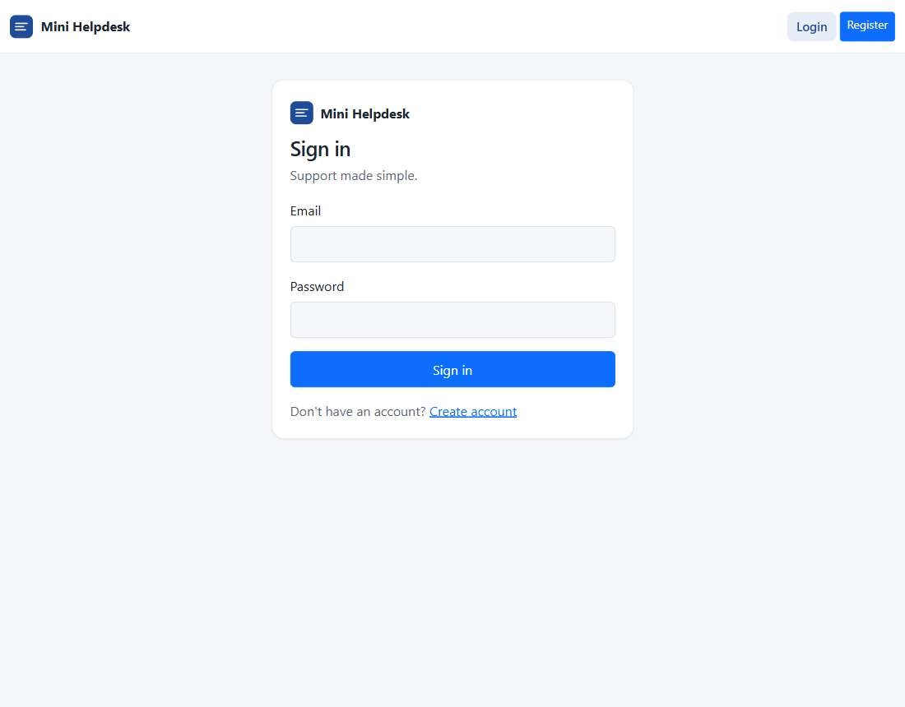
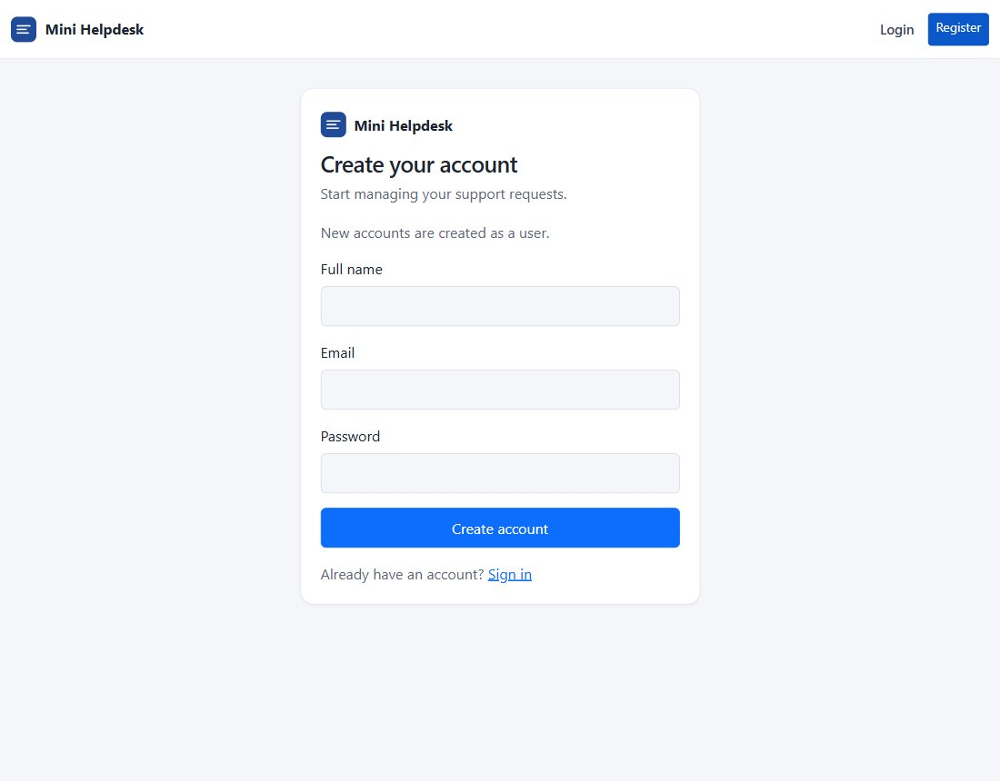
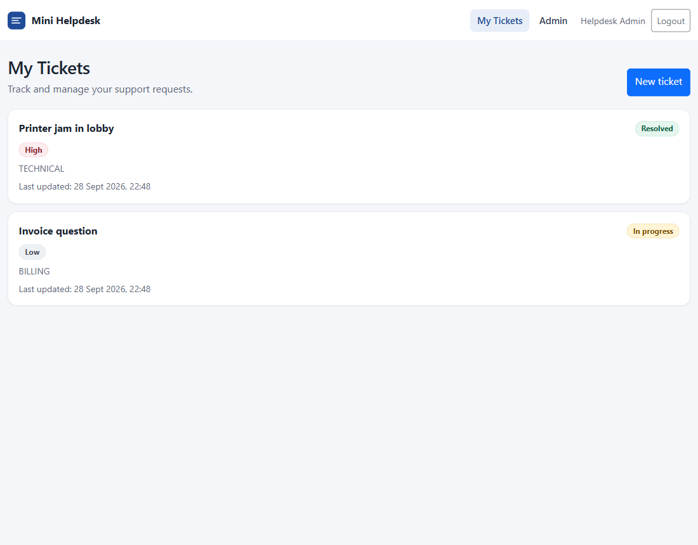
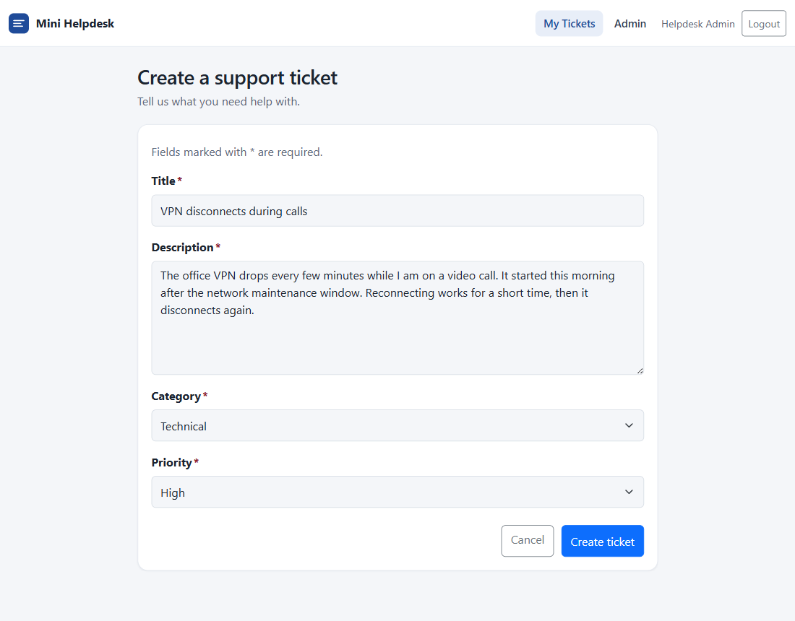
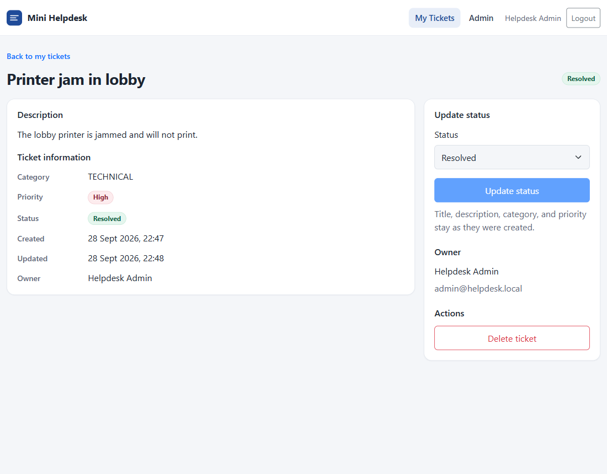
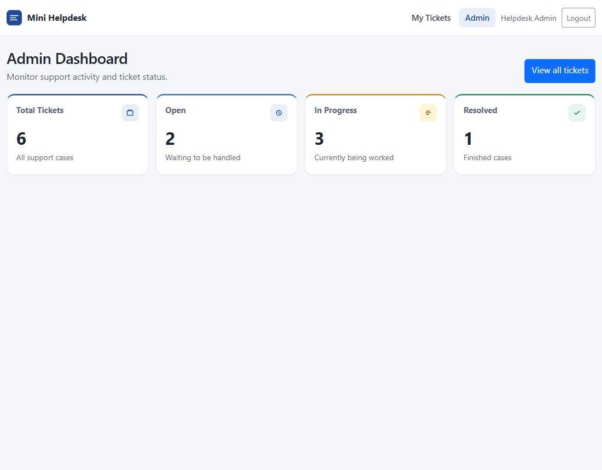
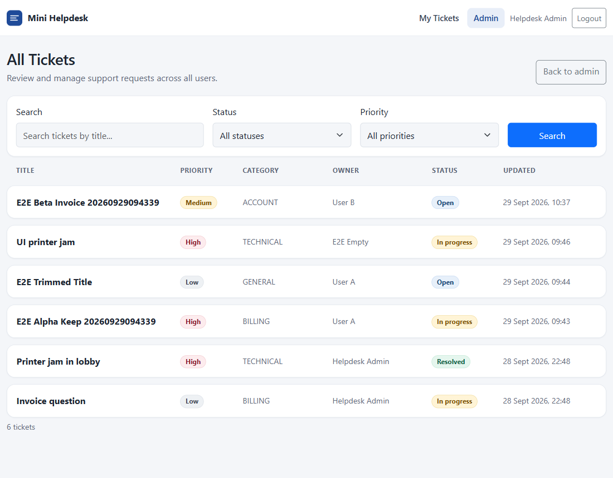

# Mini Helpdesk & Support Ticket System

A small support-ticket application: one Spring Boot API, one React frontend, and one MySQL database.

A signed-in user can register, sign in, and manage only their own tickets. An admin can see every ticket, search and filter them, change any status, and read the counts. Title, description, category, and priority stay as they were created. Only status can change.

## Tech stack

- Backend: Java 17, Spring Boot 4.1.1, Spring Web, Spring Security, JWT (jjwt 0.12.7), Spring Data JPA, Hibernate, Bean Validation, MySQL Connector/J, Maven
- Frontend: React 19, Vite 8, React Router 7, Axios, Bootstrap 5
- Database: MySQL 8

There is no API gateway, no second service, and no Docker setup. Logout does not use a token blacklist or refresh tokens.

## Prerequisites

- JDK 17
- Node.js 20 or newer
- MySQL 8 listening on localhost port 3306

Maven does not need to be installed. Use the wrapper in `backend`.

## Project layout

```text
mini-helpdesk/
  README.md
  docs/screenshots/
  backend/          Spring Boot API, package com.helpdesk
  frontend/         React app
```

## 1. Create the database

```sql
CREATE DATABASE IF NOT EXISTS helpdesk
  CHARACTER SET utf8mb4
  COLLATE utf8mb4_unicode_ci;
```

The database name stays `helpdesk`. `DB_USERNAME` and `DB_PASSWORD` have no default. The API does not start when either one is missing.

Hibernate uses `ddl-auto=update` and creates `users` and `tickets` on startup. You do not need to create the tables by hand. The columns Hibernate creates are:

**users**

| Column | Type | Rule |
|---|---|---|
| id | bigint | Primary key |
| full_name | varchar(100) | Required |
| email | varchar(150) | Required, unique, stored in lowercase |
| password_hash | varchar(255) | BCrypt hash only. The plain password is never stored |
| role | USER or ADMIN | Registration always stores USER. ADMIN comes from the seed account |
| created_at | datetime | Set on insert |

**tickets**

| Column | Type | Rule |
|---|---|---|
| id | bigint | Primary key |
| title | varchar(150) | Required. Not editable after create |
| description | varchar(2000) | Required. Not editable after create |
| category | varchar(50) | Required string, 2 to 50 characters. Not a fixed list |
| priority | LOW, MEDIUM, or HIGH | Set by the creator. Not editable after create |
| status | OPEN, IN_PROGRESS, or RESOLVED | Defaults to OPEN. This is the only field that can change |
| created_at | datetime | Set on insert |
| updated_at | datetime | Set on insert and on every status change |
| user_id | bigint | Owner. Taken from the JWT, never from the request body |

Indexes: unique email; `tickets.user_id`; `tickets.status`; `tickets.priority`. `user_id` references `users.id`.

## 2. Environment variables

`DB_USERNAME`, `DB_PASSWORD`, `JWT_SECRET`, and `ADMIN_PASSWORD` have no default. The API stops at startup if any of them is missing. The other variables have a local default.

| Variable | Default | Purpose |
|---|---|---|
| `SERVER_PORT` | `8080` | API port |
| `DB_URL` | `jdbc:mysql://localhost:3306/helpdesk` | JDBC URL. The database name stays `helpdesk` |
| `DB_USERNAME` | none, required | MySQL user |
| `DB_PASSWORD` | none, required | MySQL password |
| `JWT_SECRET` | none, required | HMAC signing key, at least 32 characters. It stays on the server and is never sent to the browser |
| `JWT_EXPIRATION_MS` | `86400000` | Access-token lifetime, 24 hours |
| `ADMIN_EMAIL` | `admin@helpdesk.local` | Seeded admin email |
| `ADMIN_PASSWORD` | none, required | Seeded admin password. Hashed with BCrypt before it is stored |
| `ADMIN_NAME` | `Helpdesk Admin` | Seeded admin display name |
| `VITE_API_URL` | `http://localhost:8080` | Frontend API base URL. Set this in `frontend` only if the API is not on port 8080 |

Set the required variables in the same terminal you use to start the API. `.env.example` lists the names with placeholders. The API does not read that file.

PowerShell:

```powershell
$env:DB_USERNAME = "<mysql username>"
$env:DB_PASSWORD = "<mysql password>"
$env:JWT_SECRET = "<random string of at least 32 characters>"
$env:ADMIN_PASSWORD = "<admin password>"
```

macOS or Linux:

```bash
export DB_USERNAME="<mysql username>"
export DB_PASSWORD="<mysql password>"
export JWT_SECRET="<random string of at least 32 characters>"
export ADMIN_PASSWORD="<admin password>"
```

A short `JWT_SECRET` also stops startup. The admin account is created once, the first time `ADMIN_EMAIL` is missing. Restarting the API does not reset that password. Do not commit a `.env` file or these values.

## 3. Run the backend

From `backend`:

```powershell
.\mvnw.cmd spring-boot:run
```

On macOS or Linux, use `./mvnw spring-boot:run` instead.

The API listens on http://localhost:8080. Confirm MySQL is reachable:

```powershell
curl http://localhost:8080/api/health
```

```json
{"database":"helpdesk","status":"UP"}
```

## 4. Run the frontend

From `frontend`, in a second terminal:

```powershell
npm install
npm run dev
```

Open http://localhost:5173.

The browser calls the API at `VITE_API_URL`, or `http://localhost:8080` when that variable is unset. The API allows `http://localhost:5173` and `http://127.0.0.1:5173`, methods `GET`, `POST`, `PUT`, `PATCH`, `DELETE`, and `OPTIONS`, and headers `Authorization` and `Content-Type`.

## How to use it

1. Open http://localhost:5173. You land on Sign in.
2. Create an account. New accounts are always `USER`. After registration, sign in. The app does not sign you in automatically.
3. My tickets lists only your tickets. Create one, open it, change the status, or delete it. Delete asks for confirmation and is permanent.
4. Sign in as the seeded admin with `ADMIN_EMAIL` and the `ADMIN_PASSWORD` you set. Unless you changed it, the email is `admin@helpdesk.local`. The navbar shows **Admin**. The dashboard shows total, open, in progress, and resolved. All tickets searches by title and filters by status and priority together.
5. Logout removes the token from this browser. It does not invalidate the token on the server.

A normal user has no Admin link. Opening `/admin` or `/admin/tickets` returns them to My tickets.

## Screens

Sign in. Field errors appear under the inputs. A wrong password shows the API message.



Create an account. A duplicate email shows “Email is already registered.”



My tickets. The list is empty until the signed-in user creates one.



New ticket. Category choices are TECHNICAL, BILLING, ACCOUNT, and GENERAL, plus Other for any other text of 2 to 50 characters.



Ticket detail. Status can move freely among Open, In progress, and Resolved. The owner can delete the ticket. An admin who opened it from All tickets sees the same page and can change the status, but the delete button is only shown to the owner.



Admin counts.



All tickets. Title, status, and priority combine with AND. A search with no matches says “No tickets match these filters.”



While a list or the dashboard is loading, the page shows a spinner. If the API cannot be reached, the page shows the error and a Try again button.

## Authentication

Login returns a signed JWT. The React app stores only that token in `localStorage` under the key `helpdesk_token` and sends `Authorization: Bearer <token>`. Passwords are never written to the browser.

The token is HS256. Claims are `sub` (email), `userId`, `role` (`USER` or `ADMIN`), `iat`, and `exp`. There is no refresh token. Logout deletes `helpdesk_token` in the browser.

Missing or invalid tokens on a protected API return `401` with message `Authentication is required`. A wrong login returns `401` with message `Invalid email or password`.

## API

JSON in and out. Send `Content-Type: application/json` on requests with a body. Protected routes need the bearer token.

| Method | Path | Access | Result |
|---|---|---|---|
| GET | `/api/health` | Public | `200` with `status` UP and `database` helpdesk |
| POST | `/api/auth/register` | Public | `201` user profile. Role is USER |
| POST | `/api/auth/login` | Public | `200` token, token type, email, name, role |
| GET | `/api/auth/me` | Signed in | `200` current user |
| POST | `/api/tickets` | Signed in | `201` ticket owned by the caller |
| GET | `/api/tickets` | Signed in | `200` the caller’s tickets, newest update first |
| GET | `/api/tickets/{id}` | Owner or admin | `200` ticket |
| PATCH | `/api/tickets/{id}/status` | Owner or admin | `200` updated ticket |
| DELETE | `/api/tickets/{id}` | Owner | `204` empty body. Admin receives `403` |
| GET | `/api/admin/tickets/stats` | Admin | `200` total, open, inProgress, resolved |
| GET | `/api/admin/tickets` | Admin | `200` matching tickets plus total, page, and size |
| PATCH | `/api/admin/tickets/{id}/status` | Admin | `200` updated ticket |

### Register

```powershell
curl.exe -X POST http://localhost:8080/api/auth/register -H "Content-Type: application/json" -d "{\"fullName\":\"Asha Kumar\",\"email\":\"asha@example.com\",\"password\":\"password123\"}"
```

`fullName` is 2 to 100 characters. `email` must be a valid address up to 150 characters. `password` is 8 to 72 characters. A duplicate email returns `409`.

```json
{"id":2,"fullName":"Asha Kumar","email":"asha@example.com","role":"USER"}
```

### Login and current user

```powershell
curl.exe -X POST http://localhost:8080/api/auth/login -H "Content-Type: application/json" -d "{\"email\":\"asha@example.com\",\"password\":\"password123\"}"

curl.exe http://localhost:8080/api/auth/me -H "Authorization: Bearer <token>"
```

Email matching on login is case-insensitive. The login body is `email` and `password`.

```json
{"token":"<jwt>","tokenType":"Bearer","email":"asha@example.com","fullName":"Asha Kumar","role":"USER"}
```

### Tickets

```powershell
curl.exe -X POST http://localhost:8080/api/tickets -H "Authorization: Bearer <token>" -H "Content-Type: application/json" -d "{\"title\":\"Cannot sign in\",\"description\":\"The login page returns an error after submit.\",\"category\":\"NETWORK\",\"priority\":\"HIGH\"}"

curl.exe http://localhost:8080/api/tickets -H "Authorization: Bearer <token>"

curl.exe -X PATCH http://localhost:8080/api/tickets/1/status -H "Authorization: Bearer <token>" -H "Content-Type: application/json" -d "{\"status\":\"IN_PROGRESS\"}"

curl.exe -X DELETE http://localhost:8080/api/tickets/1 -H "Authorization: Bearer <token>"
```

Create fields: `title` 3 to 150, `description` 10 to 2000, `category` 2 to 50, `priority` one of `LOW`, `MEDIUM`, `HIGH`. Any extra owner id in the body is ignored. Status starts as `OPEN`.

A ticket response looks like:

```json
{
  "id": 1,
  "title": "Cannot sign in",
  "description": "The login page returns an error after submit.",
  "category": "NETWORK",
  "priority": "HIGH",
  "status": "OPEN",
  "createdAt": "2026-09-28T22:00:00",
  "updatedAt": "2026-09-28T22:00:00",
  "owner": {"id": 2, "fullName": "Asha Kumar", "email": "asha@example.com", "role": "USER"}
}
```

Another user’s ticket returns `403` with message `You can only access your own ticket`. A missing ticket returns `404` with message `Ticket not found`. An admin can view and change status, and still receives `403` on delete.

### Admin list and counts

`title`, `status`, and `priority` are optional and combine with AND. A blank title is ignored. Title search is a case-insensitive contains match, and the characters `%`, `_`, and `\` are escaped. Results are sorted by `updatedAt` descending, then `id` descending.

Leave off both `page` and `size` to receive every match. The response then uses `page` 0 and `size` equal to the number of matches. If either `page` or `size` is sent, `page` defaults to 0 and `size` defaults to 10. `size` must be from 1 to 50. `page` cannot be negative.

```powershell
curl.exe "http://localhost:8080/api/admin/tickets?title=printer&status=OPEN&priority=HIGH" -H "Authorization: Bearer <admin-token>"

curl.exe http://localhost:8080/api/admin/tickets/stats -H "Authorization: Bearer <admin-token>"
```

```json
{"tickets":[],"total":0,"page":0,"size":0}
```

```json
{"total":2,"open":0,"inProgress":1,"resolved":1}
```

A user who calls an admin route receives `403` with message `Access denied`.

## Errors

Failed requests use one JSON shape:

```json
{"timestamp":"2026-09-28T16:30:00Z","status":400,"message":"Validation failed","errors":{"title":"size must be between 3 and 150"}}
```

`errors` is an empty object when the failure is not a field validation error.

| Status | When |
|---|---|
| 400 | Validation failed, the body cannot be read, a status or priority is not one of the allowed values, or page/size is out of range |
| 401 | Missing or invalid token, or the email and password do not match |
| 403 | The caller is not the owner, or is not an admin on an admin route |
| 404 | The ticket does not exist |
| 409 | The email is already registered |

The forms show `errors` next to each field. Other failures show `message`.
